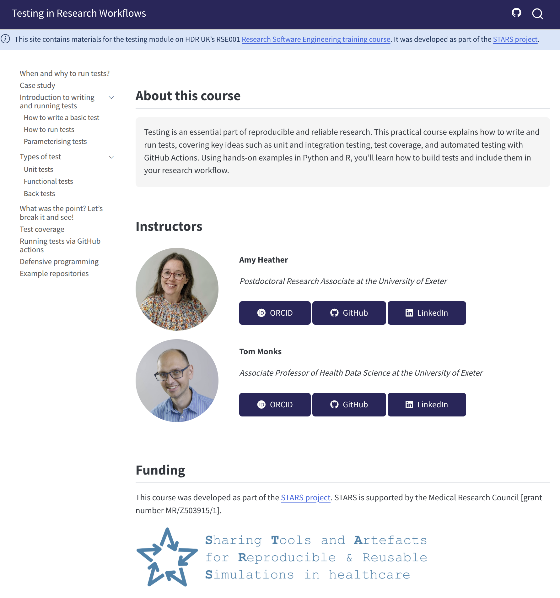
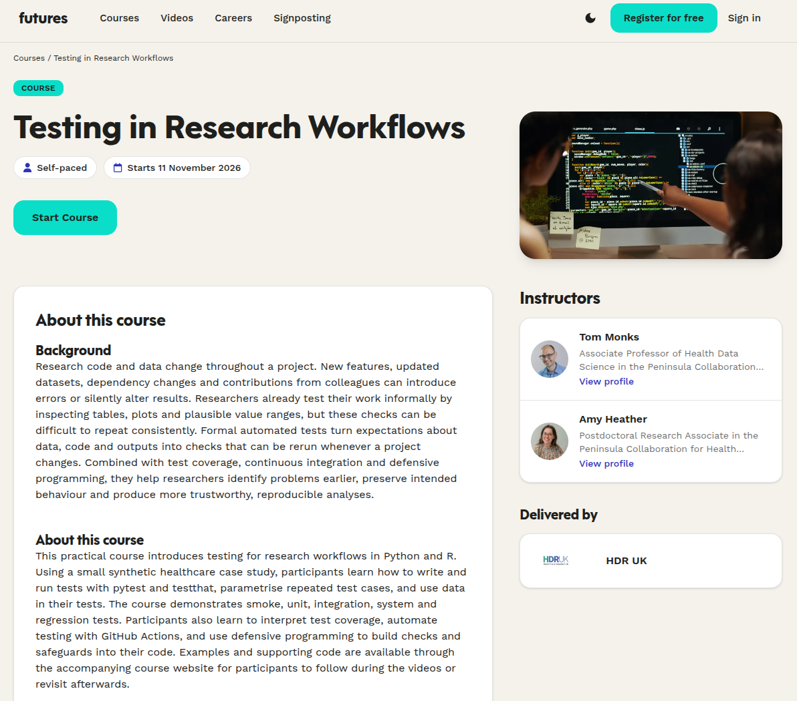

# STARS: Testing in Research Workflows

This repository contains the code behind the website on **Testing in Research Workflows**, developed as part of the <a href='https://pythonhealthdatascience.github.io/stars/' target='_blank'>STARS project</a>. (Sharing Tools and Artefacts for Reproducible Simulation). The materials help researchers integrate testing practices into their workflows, with guidance on testing in Python and R.

These resources are used in the HDR UK <a href='https://hdruklearn.org/courses/course-v1:HDRUK+STARS001+2026' target ='_blank'>Testing in Research Workflows course</a>, but are also intended as a reusable, open educational resource for the wider research software community.
    
You can view the website here: <https://pythonhealthdatascience.github.io/stars-testing-intro/>

You can find the videos for this course via the HDR UK Futures platform:

For an explanation of how this site is set up and quality-controlled, please see `CONTRIBUTING.md`.

## Licence

This work is shared:

* Code licence - MIT
* Text licence - CC-BY-SA 4.0

## Citation

To cite this work, see the `CITATION.cff` file in this repository or use the "Cite this repository" button on GitHub.

## Archive

This repository is archived on Zenodo - DOI: [10.5281/zenodo.18311754](https://doi.org/10.5281/zenodo.18311754).

## Funding

This project is supported by the Medical Research Council [grant number MR/Z503915/1].